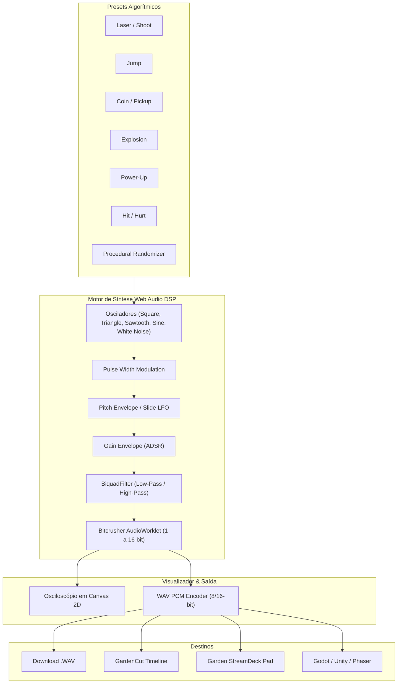

# 🌿 Garden SFX Lab

> **Gerador Procedural de Efeitos Sonoros Retro & Chiptune para Games (8-bit / 16-bit)** com síntese em tempo real via Web Audio API, presets algorítmicos instantâneos (*sfxr / bfxr* modernizado), osciloscópio dinâmico e exportação em WAV sem compressão.

---

## 🎯 Por que o Garden SFX Lab?

Durante **Game Jams** (como Ludum Dare, GMTK e Global Game Jam) ou no desenvolvimento de jogos indie retrô, encontrar efeitos sonoros com a licença correta, no formato certo e sem ruído de compressão consome horas preciosas.

O clássico *sfxr* (criado por Tomas Pettersson em 2007) revolucionou o desenvolvimento indie, mas suas implementações web modernas são antigas, feitas em Flash, com interfaces datadas e sem integração direta com outros softwares de produção.

O **Garden SFX Lab** traz o gerador procedural definitivo para a era moderna:
* **Geração Instantânea em 1 Clique:**
  * 🔫 **Laser / Shoot:** Disparos de plasma e tiros espaciais com sweep de frequência descendente.
  * 🦘 **Jump:** Saltos acrobáticos e impulsos com sweep ascendente.
  * 💥 **Explosion:** Ruído branco denso com decaimento longo e filtro passa-baixa.
  * 🪙 **Coin / Pickup:** Acordes arpejados rápidos em onda quadrada (*Square Wave*) ou senoide pura.
  * ⚡ **Power-Up:** Arpeggios ascendentes de 3 a 5 notas com vibrato e modulação de pulso (PWM).
  * 💔 **Hit / Hurt:** Ruído misturado com onda triangular e pitch descendente brusco.
  * 🔘 **Blip / Select:** Sons minimalistas de confirmação de menus e botões de UI.
  * 🎲 **Mutate / Randomize:** Algoritmo generativo para criar sons cósmicos inéditos a cada clique.
* **Modelagem Sonora Paramétrica:**
  * Envelopes ADSR completos (Attack, Decay, Sustain, Release).
  * Modulação de Frequência e Pitch Envelope (Slides ascendentes e descendentes).
  * Filtros ressonantes (Low-Pass e High-Pass com controle de corte e ressonância).
  * Efeito Lo-Fi / Bitcrush (redução de profundidade de bits de 1 a 16 bits para crocância chiptune).
* **Osciloscópio em Tempo Real:** Renderização visual da onda sonora gerada em 60 FPS com Canvas 2D.
* **Exportação Universal de Áudio:** Download em `.wav` de 8-bit, 16-bit e 24-bit (Little-Endian PCM).
* **Sinergia Total no GC Studio:**
  * Envia sons com 1 clique para a trilha `track-audio` do [GardenCut](https://github.com/FelipeGardenghiDev/garden-cut).
  * Sons compatíveis com pads do [Garden StreamDeck](https://github.com/FelipeGardenghiDev/garden-streamdeck).
  * Sons prontos para importar em Godot, Unity, Phaser e [Emo Rescue Game](https://github.com/FelipeGardenghiDev/emo-rescue-game).

---

## 🏛️ Arquitetura do Software

---

## 🛠️ Stack Tecnológica

* **Linguagem:** TypeScript 5.8+
* **Framework:** React 19 + Vite 8
* **Síntese DSP:** Web Audio API (`AudioContext`, `OscillatorNode`, `BiquadFilterNode`, `AudioWorklet`)
* **Visualização:** HTML5 Canvas 2D
* **Codificação:** PCM WAV Encoder em TypeScript puro

---

## 🌿 Ecossistema GC Studio

Este projeto integra o ecossistema de aplicações criativas mantidas pelo estúdio **GC Studio** (Felipe Gardenghi).  
Para conhecer outras ferramentas da suíte:
* 🎬 **[GardenCut](https://github.com/FelipeGardenghiDev/garden-cut):** Editor de vídeo não-linear web.
* 🎨 **[Garden Pixel Editor](https://github.com/FelipeGardenghiDev/garden-pixel-editor):** Editor de pixel art e isometria 2:1.
* 🕹️ **[Garden StreamDeck](https://github.com/FelipeGardenghiDev/garden-streamdeck):** Mesa de controle sem fio para OBS.
* 🥁 **[SimpleDrums](https://github.com/FelipeGardenghiDev/SimpleDrums):** Bateria virtual e sampler de ritmo.
* 🏛️ **[GC Studio Hub](https://github.com/FelipeGardenghiDev/gcstudio):** Central oficial do estúdio.

---

## 📄 Licença
Distribuído sob a licença MIT. Criado por Felipe Gardenghi.
